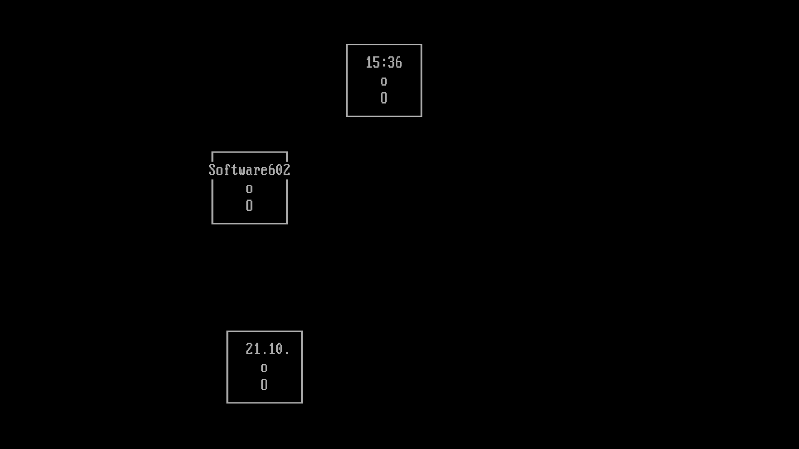

# M602 Screensaver



The screen saver of Software602 **Manažer M602 v2.00** (DOS, 1991–92) as a
native Windows and macOS screen saver: three boxes, `Software602`, the date and the
time, drifting over a black VGA text screen.

It is made from the [matching decompilation of the original
M602](https://github.com/missingno7/m602_recon), whose reconstructed Pascal
source compiles back to the original machine code. The saver logic is a
mechanical translation of that source, aiming for high accuracy of both the
original implementation and the original experience:

- The movement, random number generator, shared state, update order and
  screen writes are the original's, checked frame by frame against the
  reconstructed source compiled with Turbo Pascal 6.01.
- Timing follows the original BIOS timer ticks: one step every 2 ticks,
  about 9.1 per second.
- The picture is the VGA text mode as seen on a 4:3 CRT: 9×16 character cells,
  M602's own KeybCS font and the original palette.
- On widescreen monitors the text screen gets more columns (107×25 on 16:9)
  instead of stretched characters.

Only the old machine is replaced; [docs/FIDELITY.md](docs/FIDELITY.md) lists
what was translated, replaced or adapted, and the evidence for it.

## Install

Download from the [latest release](https://github.com/missingno7/m602_scr/releases/latest).

**Windows:** right-click `M602Saver.scr` and choose **Install**.

**macOS 11 or newer:** unzip `M602Saver-macOS.zip` and double-click
`M602Saver.saver`. The bundle is not notarized, so macOS blocks it at first.
Allow it in *System Settings → Privacy & Security*, or run:

```bash
xattr -dr com.apple.quarantine M602Saver.saver
```

## Settings

| Setting | Default |
|---|---|
| Speed, 10–400 % (double-click the slider thumb to reset) | 100 % (original) |
| Color of the text | `#AAAAAA` (original) |
| Scanlines: Off / Subtle / Strong | Off |
| Text area: Widescreen / 80×25 | Widescreen |

## Build

CMake 3.21 or newer with Visual Studio 2022+ (Windows) or Xcode command line
tools (macOS):

```bash
cmake -S . -B build -DCMAKE_BUILD_TYPE=Release -DM602_EXE=path/to/M602X.EXE
```

```bash
cmake --build build --config Release
```

The result is `build/Release/M602Saver.scr` on Windows and
`build/M602Saver.saver` on macOS.

`M602_EXE` points to an original `M602X.EXE`, and the build takes M602's
KeybCS font from it. Without it, the IBM VGA font in `assets/` is used.
GitHub Actions builds both platforms; it uses M602's font when the
`M602_FONT_B64` secret holds it.

## Tests

`saver_tests` (in the build directory) replays the reference traces in `tests/dosref`, 6,300 frames
recorded from the reconstructed `SAVER.PAS` running under Turbo Pascal 6.01,
and compares the full saver state and screen after every frame. It also tests
the random number generator, BIOS-tick timing and the renderer. The traces are
regenerated with `tests/dosref/gen_reference.py`.

## License

GPL-2.0-or-later, see [LICENSE](LICENSE). `assets/vga_ibm_8x16.bin` is the IBM
VGA font as included in DOSBox Staging (GPL-2.0-or-later). Manažer M602 is a
product of Software602.
